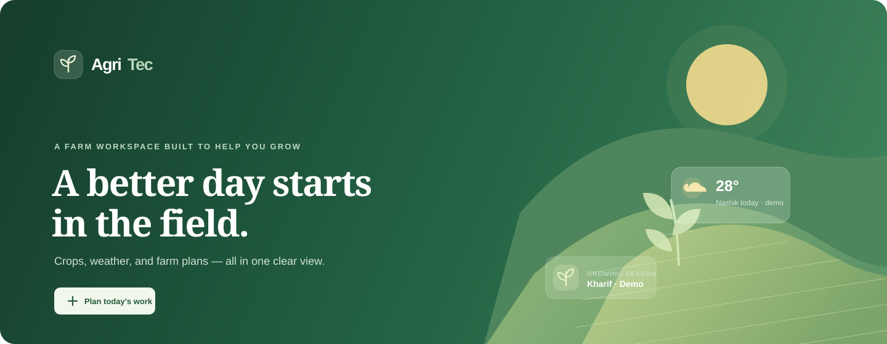
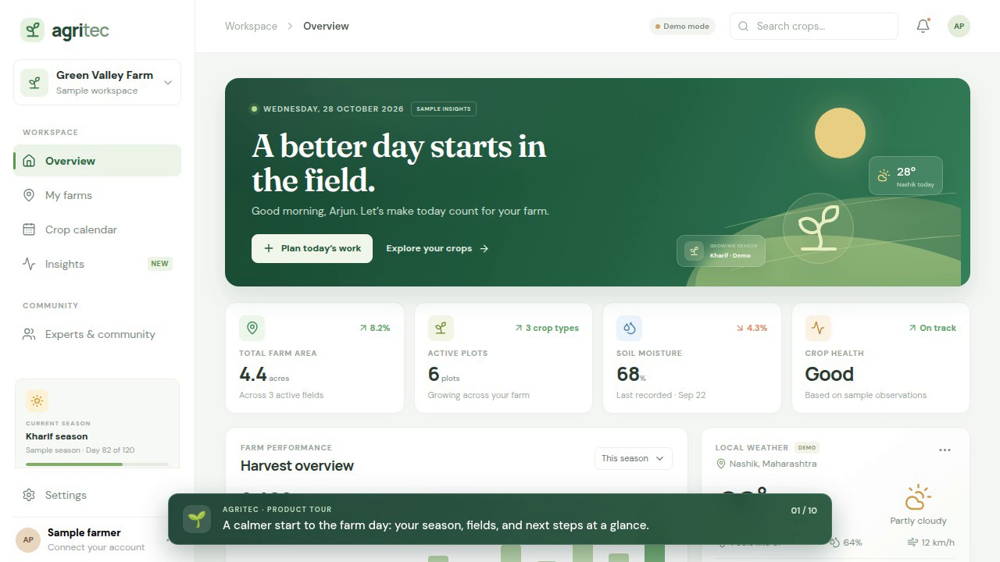

<p align="center">
  
</p>

<h1 align="center">AgriTec</h1>

<p align="center"><strong>Farm smarter. Grow stronger.</strong><br />A friendly digital workspace for the people who grow our food.</p>

<p align="center">
  
  
  
  
  
</p>

---

AgriTec brings crop planning, farm records, and practical field insights into one responsive workspace. The interface is designed to feel calm and clear on a phone or a desktop, with a backend foundation for secure accounts and persistent farm data.

### Two-minute product tour

<p align="center"><strong>720p H.264 · captioned walkthrough</strong></p>

<p align="center">
  <a href="https://github.com/arnavsx3/AgriTec/issues/1">
    
  </a>
</p>

<p align="center">Select the preview to play the video on GitHub.</p>

<p align="center"><a href="./demo/AgriTec-demo.mp4">Download the compressed MP4</a></p>

## What you can do

| Workspace | What’s there |
| --- | --- |
| **Overview** | A farm dashboard, seasonal progress, sample local weather, and a daily task planner |
| **My farms** | Browse sample fields or sign in to create and view your saved farms |
| **Crop calendar** | Follow growing stages and see saved crops from your account |
| **Insights** | Explore example soil and crop observations, clearly marked as illustrative |
| **Community** | Preview discussion and expert support concepts |
| **Account** | Register or sign in with hashed passwords and rotating refresh sessions |

### What is live, and what is sample data?

The sign-in flow and farm/crop API use MongoDB when configured. Signed-in users can create and view farms and crops in the app. The dashboard’s weather, soil, charts, field tips, community posts, and task list are sample content; they are not live readings or persisted records. Live weather, sensor feeds, notifications, orders, community posting, consultations, and admin tools remain planned work.

## Get started

### Frontend demo

Requires Node.js **20.19+** or **22.12+** and npm.

```bash
npm install
npm run dev
```

Open the local URL shown by Vite. With no API running, AgriTec opens in sample-data mode.

### Full local app

A local MongoDB server or MongoDB Atlas database is required for accounts and saved records.

```bash
cp .env.example .env
```

Edit `.env` and set `MONGODB_URI`, two different random JWT secrets (each at least 32 characters), and `VITE_API_URL`. Then run both the React app and API:

```bash
npm run dev:all
```

The API runs at `http://localhost:4000`. Its health endpoint is `http://localhost:4000/api/v1/health`. Use your profile button in the app to register or sign in, then add farms and crops from their respective views.

For separate terminals, use `npm run dev` for Vite and `npm run api:dev` for the API. To create a production frontend bundle:

```bash
npm run build
```

## API at a glance

All endpoints are under `/api/v1`. Farm and crop routes require a bearer access token; the API checks record ownership on each request.

| Area | Routes |
| --- | --- |
| **Session** | `POST /auth/register`, `POST /auth/login`, `POST /auth/refresh`, `POST /auth/logout`, `GET /auth/me` |
| **Farms** | `GET/POST /farms`, `GET/PATCH/DELETE /farms/:farmId` |
| **Farm crops** | `GET/POST /farms/:farmId/crops` |
| **Crops** | `PATCH/DELETE /crops/:cropId` |
| **Status** | `GET /health` |

The API uses Express, Mongoose, Zod validation, bcrypt password hashing, short-lived JWT access tokens, rotated refresh tokens in HttpOnly cookies, and authentication rate limits. See [architecture.md](./architecture.md) for the data model, security choices, and roadmap.

## Project map

```text
src/                  React + Vite app and API client
server/src/models/     MongoDB User, Farm, and Crop models
server/src/routes/     Authentication, farm, and crop endpoints
server/src/middleware/ Access checks, validation, and error handling
public/                Static assets and README cover art
```

## Useful commands

| Command | Purpose |
| --- | --- |
| `npm run dev` | Start the Vite frontend |
| `npm run api:dev` | Start the Express API in watch mode |
| `npm run dev:all` | Start frontend and API together |
| `npm run lint` | Check JavaScript and JSX |
| `npm run build` | Build the production frontend |

---

<p align="center"><strong>AgriTec</strong> · Individual university project · Built with care for a more connected farming community 🌱</p>
